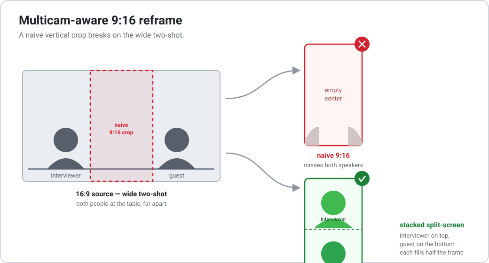

# vertical-podcast-clips

Turn a long, **multicam podcast** recording into ready-to-post **vertical short clips**
(Reels / Shorts / TikTok) — with transcription, cut selection, subtitles, and a
**multicam-aware 9:16 reframe** that uses a **stacked split-screen** whenever the edit
cuts to a wide two-shot.

<p align="center">
  
</p>

🇧🇷 _Versão em português: [README.pt.md](README.pt.md)._

---

## Why

Cropping a 16:9 podcast to 9:16 is easy — until the director cuts to a **wide two-shot**
(both people at the table). A fixed single-person crop then shows the empty middle and
neither speaker. This project's reframe solves that: single-person shots get a tall crop
centered on the speaker, and **wide two-shots become a split-screen** — one person on top,
the other on the bottom, each filling half of the 9:16.

|                | single-person shot        | wide two-shot            |
| -------------- | ------------------------- | ------------------------ |
| what you see   | 1 speaker, close          | both speakers, small     |
| naive 9:16     | ✅ crop on the speaker    | ❌ empty center, no one  |
| **this tool**  | ✅ crop on the speaker    | ✅ **stacked split**     |

## What's inside

Two pieces you can use together or separately:

- **`pipeline/`** — long video → clips
  `transcribe.sh` (whisper.cpp) → pick cuts in `cuts.tsv` → `validate.py` → `render.py`,
  which produces, per cut: a **16:9** clip, an **`.srt`**, and a **9:16** clip; and per
  episode a curation **`.docx`**. Supports **stitching** non-adjacent segments into one cut.
- **`reframe/`** — multicam-aware 9:16
  `find_wides.sh` (scene-detect the wide two-shots) → `reframe.py` (single-person crop +
  **split-screen** on the wide ranges), hard cut by default or optional cross-dissolve.

## Requirements

- **ffmpeg** / **ffprobe** (in `PATH`, or set `$FFMPEG` / `$FFPROBE`)
- **python3** (`python-docx` is auto-installed on first `.docx` render)
- **[whisper.cpp](https://github.com/ggerganov/whisper.cpp)** — only for `transcribe.sh`
  (skip it if you already have `.vtt` transcripts). Point `$WHISPER` / `$MODEL` at your build.

## Quick start

```bash
# 0) put each episode video in a project folder, e.g.  ~/my-podcast/EP01.mp4

# 1) transcribe (creates EP01.vtt / EP01.txt next to the video)
pipeline/transcribe.sh ~/my-podcast          # $LANG=en by default

# 2) choose the cuts: read the .txt, fill pipeline/cuts.tsv
cp examples/cuts.example.tsv pipeline/cuts.tsv   # then edit
#    (see criteria.md for what makes a good cut, and the column docs in the example)

# 3) validate + render 16:9 + 9:16 + .srt + .docx
pipeline/validate.py --dir ~/my-podcast
pipeline/render.py   --dir ~/my-podcast

# or all three in one command (it stops after step 1 until cuts.tsv is filled):
pipeline/make_cuts.sh ~/my-podcast
```

### Output layout

```
my-podcast/
  EP01/
    EP01.mp4  EP01.vtt  EP01.txt      # the full episode + transcript
    horizontal/  EP01_cut1.mp4  EP01_cut1.srt  ...
    vertical/    EP01_cut1_9x16.mp4   ...
    EP01_cuts.docx                    # curation doc
```

`render.py` finds the source video whether it sits in the project root or already inside
`EP01/`, so you can organize before or after rendering.

## cuts.tsv

TAB-separated, one row per cut. Key columns: `ep source start end title quote theme why
score cx segments`. Two features worth knowing:

- **`cx`** — horizontal face center (0–1) for the plain 9:16 crop, per cut.
- **`segments`** — `start->end;start->end` to **stitch** complementary pieces into one cut
  (the `.srt` follows the stitch). Great for setup-in-one-place, payoff-in-another.

See [`examples/cuts.example.tsv`](examples/cuts.example.tsv) for the full column docs and
[`criteria.md`](criteria.md) for how to pick cuts that work.

## Multicam split-screen reframe

The plain 9:16 from `render.py` assumes a single locked shot. If your footage is a
**multicam** edit that cuts to wide two-shots, reframe those clips:

```bash
# 1) find the wide two-shot ranges (prints segments + a contact sheet to eyeball them)
reframe/find_wides.sh EP01/horizontal/EP01_cut1.mp4

# 2) rebuild the 9:16: crop on the speaker for close-ups, split-screen on the wide ranges
reframe/reframe.py EP01/horizontal/EP01_cut1.mp4 out_9x16.mp4 \
    --closeup 0.52 --split 0.30,0.82 --wide 16.9-23.5
```

- `--closeup CX` — face center (0–1) for single-person shots.
- `--split A,B` — face centers of the two people in the wide shot (A = top, B = bottom).
- `--wide S-E …` — the wide two-shot ranges (seconds).
- `--split-height F` / `--split-y F` — how tight the split is (smaller `F` = closer).
- `--crossfade D` — cross-dissolve `D`s at each transition (default: hard cut).

**Calibrating the centers:** grab a frame of a wide two-shot
(`ffmpeg -ss <t> -i clip.mp4 -frames:v 1 f.jpg`), eyeball each person's horizontal position
as a 0–1 fraction, and pass them to `--split`. Do the same for `--closeup` on a single-person
frame. Positions are fixed per set/camera, so you calibrate once per show.

## Notes

- Encoding (quality-first): `libx264 -preset slow`, `-crf 18` for final/vertical
  and `-crf 16` for the 16:9 base (it doubles as a deliverable and as the source the
  vertical re-encodes from, so a cleaner base avoids stacked compression). AAC 192k,
  `yuv420p`, `+faststart`, and `scale=…:flags=lanczos` for the downscale to 1080×1920.
- The pipeline was built for a two-people-across-a-table podcast set; the split geometry
  assumes that layout (one person left, one right in the wide shot).
- Language-agnostic: set `$LANG` for whisper; the rubric/docs ship in EN + PT.

## Author

Built by **Luis Azevedo** — available for freelance / consulting work on podcast editing,
short-form video, and automation pipelines like this one.
📬 [username.azevedo@gmail.com](mailto:username.azevedo@gmail.com)

## License

MIT — see [LICENSE](LICENSE).
