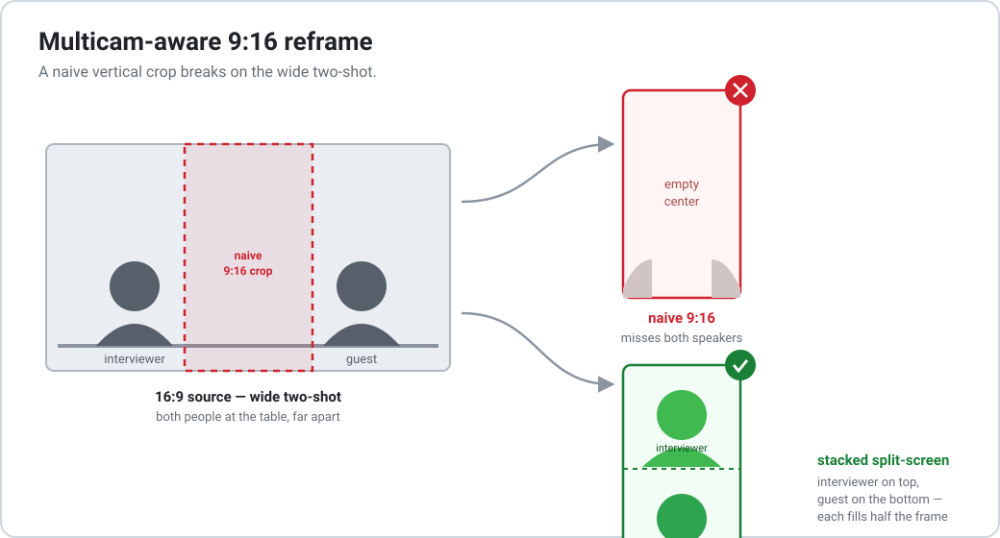

# vertical-podcast-clips

Transforma uma gravação longa de **podcast multicam** em **cortes verticais** prontos pra
postar (Reels / Shorts / TikTok) — com transcrição, seleção de cortes, legendas e um
**reframe 9:16 que entende multicam**, usando **split-screen empilhado** sempre que a
edição corta pro plano aberto (os dois na mesa).

<p align="center">
  
</p>

🇺🇸 _English version: [README.md](README.md)._

---

## Por quê

Recortar um 16:9 pra 9:16 é fácil — até a direção cortar pro **plano aberto** (as duas
pessoas na mesa). Aí um crop fixo numa pessoa mostra o meio vazio e ninguém direito. O
reframe deste projeto resolve: closes viram um crop alto na pessoa que fala, e o **plano
aberto vira split-screen** — uma pessoa em cima, a outra embaixo, cada uma preenchendo
metade do 9:16.

## O que tem aqui

Duas partes, usáveis juntas ou separadas:

- **`pipeline/`** — vídeo longo → cortes
  `transcribe.sh` (whisper.cpp) → escolher cortes no `cuts.tsv` → `validate.py` →
  `render.py`, que gera por corte: um **16:9**, um **`.srt`** e um **9:16**; e por episódio
  um **`.docx`** de curadoria. Suporta **costurar** trechos não adjacentes num corte só.
- **`reframe/`** — 9:16 multicam
  `find_wides.sh` (detecta os planos abertos por cena) → `reframe.py` (crop na pessoa +
  **split-screen** nos trechos abertos), corte seco por padrão ou cross-dissolve opcional.

## Requisitos

- **ffmpeg** / **ffprobe** (no `PATH`, ou via `$FFMPEG` / `$FFPROBE`)
- **python3** (`python-docx` instala sozinho no 1º `.docx`)
- **[whisper.cpp](https://github.com/ggerganov/whisper.cpp)** — só pro `transcribe.sh`
  (pule se já tiver os `.vtt`). Aponte `$WHISPER` / `$MODEL` e `$LANG=pt`.

## Uso rápido

```bash
# 1) transcrever (gera EP01.vtt / EP01.txt ao lado do vídeo)
LANG=pt pipeline/transcribe.sh ~/meu-podcast

# 2) escolher os cortes: ler o .txt e preencher pipeline/cuts.tsv
cp examples/cuts.example.tsv pipeline/cuts.tsv   # e edite
#    (veja criteria.pt.md pro que faz um bom corte)

# 3) validar + renderizar 16:9 + 9:16 + .srt + .docx
pipeline/validate.py --dir ~/meu-podcast
pipeline/render.py   --dir ~/meu-podcast

# ou tudo num comando (para após o passo 1 até o cuts.tsv estar preenchido):
pipeline/make_cuts.sh ~/meu-podcast
```

Saída: uma pasta por episódio com a íntegra + `horizontal/` + `vertical/` + `.docx`.

## Costurar trechos (stitch)

Na coluna `segments` do `cuts.tsv`, use `ini->fim;ini->fim` pra juntar pedaços
**próximos e complementares** num corte só (a legenda acompanha). Ótimo pra setup num
lugar e payoff em outro. Detalhes das colunas em
[`examples/cuts.example.tsv`](examples/cuts.example.tsv).

## Reframe split-screen (multicam)

```bash
# 1) achar os planos abertos (imprime os segmentos + um contact sheet pra conferir)
reframe/find_wides.sh EP01/horizontal/EP01_cut1.mp4

# 2) refazer o 9:16: crop na pessoa nos closes, split-screen nos planos abertos
reframe/reframe.py EP01/horizontal/EP01_cut1.mp4 saida_9x16.mp4 \
    --closeup 0.52 --split 0.30,0.82 --wide 16.9-23.5
```

- `--closeup CX` — centro do rosto (0–1) nos closes.
- `--split A,B` — centro das duas pessoas no plano aberto (A = cima, B = baixo).
- `--wide S-E …` — os trechos de plano aberto (segundos).
- `--split-height F` / `--split-y F` — o quão fechado é o split (menor `F` = mais perto).
- `--crossfade D` — cross-dissolve de `D`s (padrão: corte seco).

**Calibrar:** extraia um frame de um plano aberto, meça a posição horizontal de cada pessoa
como fração 0–1 e passe em `--split` (e o `--closeup` num frame de close). As posições são
fixas por set/câmera — calibra uma vez por programa.

## Autor

Feito por **Luis Azevedo** — disponível para freelance / consultoria em edição de podcast,
vídeo pra redes e pipelines de automação como este.
📬 [contato@midianoxx.com](mailto:contato@midianoxx.com)

## Licença

MIT — veja [LICENSE](LICENSE).
